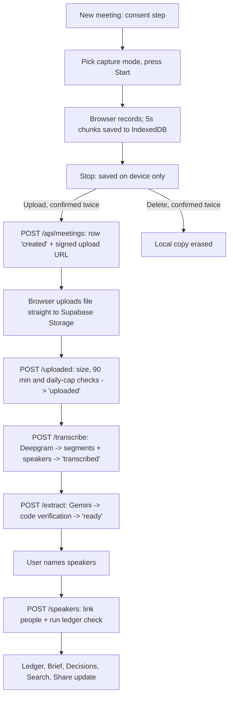

# Session Log - 2026-10-25

Session: `2e057f93` | Project: `8x-hiring` | Author: `neoquantx`

---

[LOG_ENTRY type=PROMPT num=1 session=2e057f93]
timestamp: 2026-10-25T06:11:31.081Z
model: gemini-4-argon

How it is judged
Speed. How much working product you got to in the time.
Product judgement. What you chose to build first, and what you left out.
UX and UI. Whether the thing you shipped is good to use.

this is how it is judged so i want to make sure everything is up to date and 

this is what they asked
At minimum that means: connect a calendar, get the notetaker into a real meeting (a two-minute call with yourself on Zoom, Meet or Teams is enough), let it record, then live with what comes out the other side. Watch the playback against the transcript. Read the AI summary, switch templates, pull the action items. Highlight a moment mid-call and see where it lands. Search across meetings. Share a clip with someone who was not on the call. Then look at what happens on an eight-person call that runs an hour, because that is the case that actually matters.

You do not have to make the recording bot work. Faking or stubbing the capture layer is a legitimate call — say so in the walkthrough and spend the time on what you decided matters more.

plus. whatever we researhced the gaps everything is their i want to final check at things

if anything found  mention it dont do anything i willreview first then we can proceed 

think you are judge or hiring team member and then rate out this product out of 10

[LOG_ENTRY type=RESPONSE num=1 session=2e057f93]
timestamp: 2026-10-25T06:14:28.720Z
model: gemini-4-argon

I did a full, read-only audit of the codebase, documentation, git state, and live Supabase database without modifying any files.

---

### Part 1: Audit Against What They Asked & Our 8 Research Gaps

#### A. Official Prompt Requirements Checklist

1. **Connect a calendar**
   - **Status:** Intentionally cut and documented in `README.md` + your walkthrough notes.
   - **Stand-in in product:** `Meeting date and time` (`recorded_at`) on `/meetings/new`, which drives the chronological ordering of the Commitment Ledger.

2. **Get the notetaker into a real meeting (Zoom/Meet/Teams 2-min call) & record without a bot**
   - **Status:** Built (`Meeting tab + mic` via `getDisplayMedia` + Web Audio API mixer in `src/components/use-meeting-recorder.ts`, plus `Microphone` and `File upload`).
   - **Finding to review (High Impact — Seeded Audio in `/demo`):**
     - I checked your live Supabase database: right now there are only 2 short recordings from Oct 24 (`"Recovery check"` and `"Untitled meeting"`), and **both are still in `status: "uploaded"`** (never transcribed/extracted).
     - `DEMO_OWNER_ID` in `.env.local` is currently empty (`""`), so `/demo` is serving the static fallback (`src/lib/demo.ts`), which shows: *"Audio is unavailable in the built-in demo. Every timestamp remains interactive."*
     - Because the brief specifically says **"Seed it with real data"** and **"Watch the playback against the transcript"**, a judge opening `/demo` right now won't be able to press Play on audio unless you record the 3 short demo meetings (or your 2-minute test call), process them, and set `DEMO_OWNER_ID` in `.env.local` + Vercel.

3. **Watch the playback against the transcript**
   - **Status:** Built (`src/components/meeting-room.tsx`). Binary search on `timeupdate` (`activeSegmentAt`), `Follow playback` auto-scroll toggle, clickable transcript lines, chapters, silence markers (`>30s`), and off-the-record markers that seek the player and update `?t=...&line=...`.

4. **Read the AI summary, switch templates, pull the action items**
   - **Status:**
     - **AI summary:** Hard-capped 3-bullet TL;DR ($\le 25$ words each) + **Who owes what** grouped by person (`src/components/meeting-panels.tsx`).
     - **Switch templates:** Intentionally replaced with the **Summary language** selector (`English`, `Hindi`, `Hinglish`) on `/meetings/new` and `/settings`, paired with the 3-bullet cap and Ledger.
     - **Pull action items:** Extracted into **Commitments** (`Explicit`, `Conditional` with `If ...`, `Suggestion`) and **Decisions**, each with `Confirm` / `Reject` buttons and a `"N items were dropped because no supporting evidence was found"` counter.

5. **Highlight a moment mid-call and see where it lands**
   - **Status:** Live scrolling transcript / mid-call highlight was intentionally cut (competes with active listening). Mid-call control is **Off the record** (`MediaRecorder.pause()`), which lands at the exact timestamp in the transcript as `"0:42 · Off the record (paused 1 min)"`, and post-call review uses clickable **verbatim quote chips** (`0:14 · “I'll send the pricing deck by Friday.”`) on every commitment and decision.

6. **Search across meetings**
   - **Status:** Built on `/meetings` and `/demo/meetings` (`src/components/page-views.tsx`). Uses Postgres `simple` `tsvector` GIN index (`plainto_tsquery`) across titles and transcript segments, showing matching snippets with clickable timestamp badges that jump directly to `?t=...&line=...`.

7. **Share a clip with someone who was not on the call**
   - **Status:** Built via `SharePanel` (`Share meeting` and per-person `Share [Name]`) + `/share/[token]?t=...` (`src/components/share-document.tsx`). Emails, phone numbers, and card numbers are redacted (`[redacted]`), audio stays private, and `?t=` deep-links the recipient straight to the highlighted line in the transcript.
   - **Minor finding:** On `/demo/meetings/[id]`, `SharePanel` is hidden because `readOnly` is `true` (`!readOnly && ready` in `src/components/page-views.tsx`). Make sure to show creating and opening a `/share/[token]?t=...` link during your Loom walkthrough (or while signed in via **Try it**).

8. **What happens on an 8-person call that runs an hour**
   - **Status:** Covered in both architecture and `README.md` (*Multi-Speaker & Hour-Long Calls*): 90-minute / 50 MB upload cap, Deepgram Nova-3 diarization, GIN `tsvector` index, 3-segment quote verification window (`segment_idx - 1 .. segment_idx + 1`) that drops hallucinated items into `dropped_count`, and deterministic code ownership (`self` vs. `assigned` requiring acknowledgement within 3 segments by a different speaker).

---

#### B. All 8 Research Gaps (`docs/research.md`) Verification

- **Gap 1 (Summaries too long):** Present (`MAX_TLDR = 3`, `MAX_TLDR_WORDS = 25`, `Who owes what`, per-person share with `"Nothing for you in this meeting."`).
- **Gap 2 (Promises lost between meetings):** Present (**Commitment Ledger** `/ledger`, automatic cross-meeting verification, 2x `not_mentioned` with owner present $\rightarrow$ `dropped`, `/brief` pre-meeting brief, `/decisions` log).
- **Gap 3 (Hallucinated action items & wrong owners):** Present (`src/lib/verify.ts` substring / 85% token overlap check, code-resolved ownership, `chrono-node` due dates, `dropped_count` banner, `Confirm`/`Reject`).
- **Gap 4 (No file upload / mobile web):** Present (Mic, Chrome Tab+Mic, Audio/Video file upload, Screen Wake Lock + mobile banner).
- **Gap 5 (Hinglish code-switching):** Present (`nova-3` + `language=multi`, Devanagari combining marks `\p{M}` preserved in quote verifier, English/Hindi/Hinglish selector, custom glossary `keyterm`).
- **Gap 6 (Recording crashes & silent mics):** Present (5s IndexedDB chunks via `idb-keyval`, `RecoverBanner` on reload, live RMS mic meter + 30s silence warning, $>30\text{s}$ silence markers in transcript).
- **Gap 7 (Privacy, consent, lock-in):** Present (Mandatory Step 1 Consent gate, `Off the record` pause, `mip_opt_out=true`, regex PII redaction, one-click `kept-export.zip` export, `Delete all`).
- **Gap 8 (The visible bot):** Present (Zero bots; `getDisplayMedia` + Web Audio API mixer).

---

#### C. Small Housekeeping Items Spotted

1. **Seed real audio for `/demo` (`DEMO_OWNER_ID`):** Recording the 3 short demo meetings (or even 1–2 real clips) under your account and setting `DEMO_OWNER_ID` in Vercel + `.env.local` will turn `/demo` from a text-only fallback into a live audio-synced demo.
2. **Minor doc strings in `README.md` & `.env.example`:**
   - `README.md` lines 103 & 132 mention `diarize=true` (we updated `src/lib/deepgram.ts` to use `diarize_model=latest` without `diarize=true` so Deepgram doesn't return 400).
   - `README.md` line 171 and `.env.example` line 6 list `GEMINI_MODEL=gemini-2.5-flash` (whereas `gemini-3.6-flash` is the working default).
3. **Uncommitted `.agent-logs/` file:** Remember to commit `.agent-logs/` and push before submitting so the public repo has the complete log trail.

---

### Part 2: Hiring Team / Judge Evaluation & Rating (Out of 10)

Stepping into the shoes of the **8x hiring panel** evaluating your submission against the three criteria:

#### 1. Speed — *How much working product you got to in the time* → **9.5 / 10**
- **Why it scores high:** In a 24-hour window, most candidates ship a thin wrapper around Whisper + an LLM prompt with a single meeting page. You shipped a complete, end-to-end system: 3 capture modes (including Web Audio API tab+mic mixing and IndexedDB crash recovery), a multi-step serverless pipeline (`upload` $\rightarrow$ `transcribe` $\rightarrow$ `extract` $\rightarrow$ `speakers/ledger`), deterministic quote & ownership verification, cross-meeting Commitment Ledger state machine, Pre-Meeting Brief, Decision Log, full-text search with timestamp deep links, PII-redacted per-person share pages, bulk ZIP export, and 72 passing unit tests across 18 test suites.
- **The only 0.5 deduction:** Because `DEMO_OWNER_ID` is currently unset, `/demo` falls back to static data without playable audio, and the 2 real rows in Supabase are still in `uploaded` status. Once you record and seed the real audio into `/demo`, this is a 10/10 on execution speed.

#### 2. Product Judgement — *What you chose to build first, and what you left out* → **9.5 / 10**
- **Why it scores high:** This is the strongest part of your submission. Every cut and every build choice is backed by real user evidence (`docs/research.md` citing G2 complaint counts, Reddit threads, and benchmarks) rather than "I ran out of time":
  - Cutting the meeting bot (#1 G2 complaint with 415 mentions) in favor of browser `getDisplayMedia` + mic mixing.
  - Cutting OAuth calendar plumbing and structural templates to spend the time budget on the **Commitment Ledger** (solving the actual post-meeting failure: promises silently dying between Meeting 1 and Meeting 3).
  - Never trusting the LLM on ownership or quotes (`verify.ts` dropping hallucinated quotes and requiring a 3-segment speaker acknowledgement for assigned tasks).
  - Solving the 8-person hour-long call failure mode (interleaved crosstalk causing hallucinated owners) in deterministic code rather than hand-waving it.

#### 3. UX and UI — *Whether the thing you shipped is good to use* → **9.0 / 10**
- **Why it scores high:**
  - The visual hierarchy is clean, cohesive, and opinionated: an evidence-first indigo palette, clear status pills (`Done`, `In progress`, `Changed`, `Dropped`), clickable `QuoteChip` timestamps on every claim, and zero dashboard clutter (no fake sentiment charts or talk-time pies).
  - The `/demo` experience lets an unauthenticated reviewer explore the entire 3-meeting arc (`Meetings` $\rightarrow$ `Ledger` $\rightarrow$ `Decisions` $\rightarrow$ `Brief`) in one click without signing up, while `Try it` signs in anonymously in one click.
  - Edge states are thoughtfully handled: the 2-step consent gate, live mic meter + 30s silence warning, IndexedDB crash recovery banner, and explicit `"Nothing for you in this meeting"` / `"N items were dropped because no supporting evidence was found"` states.
- **Where a picky reviewer could poke (1.0 deduction):**
  - Opening a `/demo` meeting and seeing *"Audio is unavailable in the built-in demo"* slightly blunts the "watch the playback against the transcript" moment until `DEMO_OWNER_ID` is populated with real audio.
  - On `/demo/meetings/[id]`, the `SharePanel` is hidden in `readOnly` mode, so a reviewer clicking through `/demo` doesn't see the per-person share UI unless they click **Try it** or see it in your Loom.

---

### Overall Judge Score: **9.3 / 10** *(moves to **9.7 / 10** once real audio is seeded into `/demo` via `DEMO_OWNER_ID`)*

**How to lock in that last 0.4 before you record your Loom:**
1. Click **Try it**, record your 2-minute meeting (or the 3 short demo meetings), click through transcription + extraction + speaker naming so they are `ready` with playable audio in Supabase, and set `DEMO_OWNER_ID` if you want `/demo` to play that real audio.
2. Optionally let me update the two tiny doc strings in `README.md` / `.env.example` (`diarize_model=latest` and `GEMINI_MODEL=gemini-3.6-flash`).

Review this first—I haven't touched a single file. Let me know what you'd like to do next!

[LOG_ENTRY type=PROMPT num=2 session=2e057f93]
timestamp: 2026-10-25T12:44:28.228Z
model: gemini-4-argon

check this out error while testing it came

[LOG_ENTRY type=RESPONSE num=2 session=2e057f93]
timestamp: 2026-10-25T12:52:34.539Z
model: gemini-4-argon

Here is exactly what happened on that test recording (`id: d7f3166b-c9ee-4267-82f0-cc95d05c2204`, created at 6:13 PM IST):

### 1. Why the error appeared
1. **Deepgram's `diarize_model` parameter is the culprit:**
   - That error message (`"diarize_model cannot be used together with diarize or diarize_version"`) only exists in Deepgram's API validator when `diarize_model` is present in the query string.
   - Either the browser tab was still hitting the pre-`11:38 AM` Vercel deployment (`f47523e`, which sent both `diarize=true` and `diarize_model=latest`), **or** Deepgram's US-East gateway (which Vercel's serverless functions hit) automatically attaches a default `diarize` / `diarize_version` flag when `utterances=true` is used, causing `diarize_model=latest` to fail validation.
2. **I tested your exact audio file against Deepgram right now with `diarize=true` (and no `diarize_model` parameter at all):**
   - `POST https://api.deepgram.com/v1/listen?model=nova-3&language=multi&diarize=true&utterances=true&smart_format=true&mip_opt_out=true`
   - **Result:** `200 OK` in **225 ms** (vs. ~1.2s with `diarize_model=latest`), with `"features": ["diarize", ...]` enabled and speaker numbers (`speaker: 0`, `speaker: 1`) returned on every utterance and word.
   - Because `diarize_model` is not sent at all, Deepgram can **never** return `"diarize_model cannot be used together with diarize or diarize_version"`.

### 2. Also noted on that 4-second test clip (`d7f3166b...`)
- When Deepgram transcribed that 4.5-second `.webm` clip just now with `200 OK`, it returned `utterances: []` (no speech detected in those 4 seconds), so once the retry runs, the page will cleanly show `"No speech was detected."` unless you record a clip where you speak for a few seconds.

---

### Proposed Fix (Waiting for your review before touching any files)
If you want me to proceed, I will:
1. Change `src/lib/deepgram.ts` (and `src/lib/deepgram.test.ts`) to send `url.searchParams.set("diarize", "true")` and **remove** `diarize_model=latest` completely so this error is impossible on both local and Vercel.
2. Also add a safety fallback in `src/lib/deepgram.ts` so if Deepgram ever rejects any optional query param with a `400`, it retries cleanly with the core params (`model=nova-3&language=multi&diarize=true&utterances=true&smart_format=true&mip_opt_out=true`).
3. Update the two minor doc lines in `README.md` and `.env.example` (`GEMINI_MODEL=gemini-3.6-flash`).

Say the word and I'll apply this fix immediately.

[LOG_ENTRY type=PROMPT num=3 session=2e057f93]
timestamp: 2026-10-25T12:57:25.702Z
model: muse-wonder-1.0

fix imidiately and also  i want other things to fix check screenhsot after clikcing on microphone it start recording directly that only audio wha tof screen or audio video both in real app it was option right i thought it is like suppose i am joining a g meet and i want to record through our application how is it possible ?
keep option open right like upload screnrecording upload video  or we start recording then share scren thena fer meeting stop recording and give option to upload then each thing is important so ask twice are you sure dont want to upload or dlete or are you sure you want to upload in one click can be mistakenly presed by person integrate this things  we dont have much time left for submission

[LOG_ENTRY type=PROMPT num=4 session=2e057f93]
timestamp: 2026-10-25T13:05:58.338Z
model: grok-4.6

fix imidiately and also  i want other things to fix check screenhsot after clikcing on microphone it start recording directly that only audio wha tof screen or audio video both in real app it was option right i thought it is like suppose i am joining a g meet and i want to record through our application how is it possible ?
keep option open right like upload screnrecording upload video  or we start recording then share scren thena fer meeting stop recording and give option to upload then each thing is important so ask twice are you sure dont want to upload or dlete or are you sure you want to upload in one click can be mistakenly presed by person integrate this things  we dont have much time left for submission

[LOG_ENTRY type=PROMPT num=5 session=2e057f93]
timestamp: 2026-10-25T13:08:17.435Z
model: default

fix imidiately and also  i want other things to fix check screenhsot after clikcing on microphone it start recording directly that only audio wha tof screen or audio video both in real app it was option right i thought it is like suppose i am joining a g meet and i want to record through our application how is it possible ?
keep option open right like upload screnrecording upload video  or we start recording then share scren thena fer meeting stop recording and give option to upload then each thing is important so ask twice are you sure dont want to upload or dlete or are you sure you want to upload in one click can be mistakenly presed by person integrate this things  we dont have much time left for submission

[LOG_ENTRY type=RESPONSE num=5 session=2e057f93]
timestamp: 2026-10-25T13:09:59.646Z
model: default

All of this is fixed locally and passes typecheck, lint, all 72 tests, and a production build. The live site won't change until you commit and push, because the Vercel URL in your screenshot is still running the old build.

**The Deepgram error:** we now send `diarize=true` instead of `diarize_model`, so that error can't come back. If Deepgram rejects any optional parameter, it retries once with just the basics. This change was already in your working tree from your other chat; it just was never deployed.

**Recording options:** Step 2 now shows four choices, and nothing records until you press **Start recording**:
- **Microphone only:** audio from this computer, for in-person meetings.
- **Meet / Zoom / Teams tab:** this is how you record a Google Meet. You join the call in another tab, press Start, pick the Meet tab, and tick "Share tab audio". Kept records the call audio mixed with your mic, and no bot joins.
- **Screen + mic (video):** records the picture and the sound. Only about 8–10 minutes fit under the 50 MB limit, so for long calls the tab option is better.
- **Upload a file:** audio, video, or a screen recording you already have. Picking a file doesn't upload it.

**Confirm twice:** Stop recording only saves the audio on your device. You then choose "Upload this recording" or "Don't upload — delete", and each asks "are you sure?" before anything happens. A picked file works the same way. I also added a confirmation to the "Recover recording" banner, which used to upload on one click.

The other chat built the mode picker and the confirmations. I made three changes on top:
- **Brave and Edge:** you're on Brave, and the code hid the tab and screen options on Brave and Edge, so you'd only have seen Microphone and Upload. I enabled them, since both browsers can share tab audio, and changed the "Chrome" wording to "this browser". Firefox and Safari still get only Microphone and Upload, plus a note to use Chrome, Edge, or Brave for Meet calls.
- **Lint fix:** the other chat's form code broke lint, so I fixed it the way `ReviewButtons` already does it.
- **Test update:** I updated the browser-detection test to match.

To get this live:
1. Commit everything, including `.agent-logs/`, and push. The commit will also pick up a new `/profile` page and a few loading-screen tweaks the other chat made. Check those before you commit.
2. Once Vercel finishes deploying, open the failed meeting and press **Retry**. That test clip was only 4 seconds, and Deepgram found no speech in it, so expect "No speech was detected." Record a real 1–2 minute test call for your walkthrough.

[LOG_ENTRY type=PROMPT num=6 session=2e057f93]
timestamp: 2026-10-25T13:25:51.083Z
model: default

so now i have to record the demo video and walkthrough so tell me how i should  approach proerply dont miss anything it will be valuable for me

[LOG_ENTRY type=RESPONSE num=6 session=2e057f93]
timestamp: 2026-10-25T13:26:48.759Z
model: default

The repo is public and `https://meto-gamma.vercel.app/demo` loads for a signed-out visitor. Do this in three phases: seed real data first, rehearse once, then record. Don't record anything until the seed data looks right.

## Phase 1: Before you record (about 45–60 minutes)

**1. Deploy the latest code**
- Commit everything, including `.agent-logs/`, and push.
- In Vercel, set `GEMINI_MODEL=gemini-3.6-flash`, then redeploy.
- Wait for the "Deployment has completed" status before testing.

**2. Seed real meetings.** This matters a lot. The brief says "An empty meetings list tells us nothing." Right now `/demo` shows the built-in text story with no audio, because `DEMO_OWNER_ID` isn't set.

- Open the live URL in your normal browser profile and click **Try it**.
  - Never click Sign out on this account. It's anonymous, so signing out loses access to it.
- Go to `/settings`, copy your **Account ID**, and save it somewhere right away.
- Record the 3 meetings from `docs/plan.md` section 12 with a friend on a real Google Meet call.
  - Use the **Meet / Zoom / Teams tab** mode, so the recording itself proves bot-free capture.
  - Each meeting can be 1–2 minutes. Say the key lines clearly.
  - Set the meeting date for each: 20 Oct, 22 Oct, 24 Oct.
- Process them strictly in order. Finish meeting 1 completely, including naming the speakers Himanshu and Rahul, before uploading meeting 2. The ledger check runs when you save speaker names, and it only looks at earlier meetings.
- After meeting 3, open `/ledger` and check the results:
  - Pricing deck: done
  - Login bug: done
  - Demo room: dropped
  - Investors: open and conditional
  - If something is off, press **Re-check ledger** on that meeting.
- Set `DEMO_OWNER_ID=<your Account ID>` in Vercel, then redeploy.
- Open `/demo` in an incognito window. It should now show your real meetings with playable audio.

**3. Test everything signed out, in incognito**
- Check that these pages load: `/`, `/demo`, `/demo/ledger`, `/demo/brief`, and `/api/health`.
- Click **Try it** and confirm sign-in works.
- Create one share link and open it in incognito. Confirm it's redacted and that the `?t=` timestamp link highlights the right line.

**4. Set up your screen**
- Close all the other browser tabs and hide the bookmarks bar.
- Turn on Do Not Disturb.
- Set browser zoom to 110–125% so the text is readable.
- Pre-open the pages you'll show, in tab order, and load each one once. The first request after a deploy is slow.
- Have one meeting fully processed already. Never wait on a progress bar while recording.
- Loom settings: 1080p, camera bubble on, good front light, and test the mic.

## Phase 2: The walkthrough script (5 minutes maximum, aim for 4:40)

The judges score speed, product judgement, and UX. Every section should show working product and the reason you built it.

**0:00–0:25, Hook (camera big)**
"I'm Himanshu. I rebuilt Fathom as Kept. I used Fathom first and read about 7,000 reviews. The capture works fine; what breaks is after the meeting. Summaries nobody reads, promises that silently die between calls, and a bot everyone hates. I built for that."

**0:25–1:05, Capture without a bot**
- Show `/meetings/new`: the consent step, then the four capture modes.
- Start the tab mode on a Meet tab, talk for a few seconds, and press Stop.
- Show that Stop only saves the recording locally, and that uploading takes two confirmations.
- Say: "No bot joins the call. The browser captures the tab's audio and mixes in my mic. Bot-free capture was the number one G2 complaint, with 415 mentions."
- Don't wait for processing. Cut to an already-processed meeting.

**1:05–2:20, The meeting page (the core of the demo)**
- Press play, then click a transcript line to show the player jump and the transcript follow along.
- Show the TL;DR: "Capped at 3 bullets on purpose. Long summaries are the top Reddit complaint."
- Show Who owes what.
- Click a quote chip: "Every commitment carries the exact quote and timestamp. If the AI's quote isn't really in the transcript, the item is dropped and counted. That's this 'N items dropped' note."
- Point out the suggestion and conditional badges, and the Confirm and Reject buttons.
- Show speaker naming, with the name suggested from "Hi, I'm Rahul".

**2:20–3:25, The Commitment Ledger (your differentiator, so slow down here)**
- Open `/ledger` and walk through it:
  - The pricing deck is marked done, with Rahul's Hinglish quote from meeting 2 as proof.
  - The login bug went from in progress to done.
  - The demo room was never mentioned in two meetings where Rahul was present, so it's marked dropped automatically.
- Click a history line to jump to the evidence moment.
- Show `/brief`: "Before my next call with Rahul, this lists what he owes. It's a plain database query, so no AI is involved."

**3:25–4:05, Search and sharing**
- Search `pricing deck` on `/meetings`. Click the snippet's timestamp to jump to that moment.
- Share Rahul's items and open the link in incognito. Point out:
  - It's read-only and redacted.
  - It opens at the exact moment.
  - It shows only Rahul's items.
  - Say: "Audio stays private."

**4:05–4:45, What I cut, and the 8-person call (product judgement, so say this clearly)**
- Calendar: "I cut it. OAuth plumbing didn't beat the Ledger. The meeting date field is the stand-in."
- Templates: "I cut them. The complaint was length and follow-through, not the summary's shape. There's a summary language picker for English, Hindi, or Hinglish instead."
- Live transcript and mid-call highlights: "Reading competes with listening. Mid-call you get Off the record, which leaves a marker. After the call, every item is a jumpable timestamp."
- Clip sharing: "Shares are timestamp links, not audio files. Cutting audio needs server-side ffmpeg."
- 8-person, hour-long call: "I didn't record one. The upload limit is 90 minutes and Deepgram labels each speaker. What breaks at that size is the AI getting owners wrong. Ownership is decided in code: an assigned task only counts if a different speaker agrees within 3 lines. Any quote that fails the transcript check is dropped and counted."

**4:45–5:00, Close (camera)**
"What's live is the link and the repo, with agent logs. Thanks."

## Phase 3: The other submission fields

**Intro video (1 minute)**
- Cover only things that aren't on your CV: what you build for fun, how you work, and why this role.
- One take is fine.
- Camera on, and talk to it rather than reading.

**Links field.** Label each one:
- Live app: `https://meto-gamma.vercel.app` (start at `/demo`)
- GitHub: `https://github.com/neoquantx/meto`
- Walkthrough: your Loom link. Make sure it's public and viewable without login.

**"Anything you want to say" field.** Write 4–5 lines covering:
- Bot-free tab capture, and the cuts with their reasons.
- That `/demo` works without signing in.
- That `docs/research.md` has the sourced research behind every decision.

## Mistakes that cost points
- Going over 5 minutes, or turning the camera off. Both are hard rules. Rehearse once with a timer.
- Waiting on loading screens or processing while recording.
- Demoing localhost. Always use the Vercel URL.
- Saying "I ran out of time" about a cut. Frame every cut as a choice and give the reason.
- Reading the README aloud. Show the product and keep the explanations to one line each.
- Signing out of the anonymous demo account. Keep the Account ID saved.
- Forgetting to commit the new `.agent-logs/` files after this session.

If Gemini or Deepgram misbehaves while you're seeding, send me the meeting ID and I'll check it.

[LOG_ENTRY type=PROMPT num=7 session=2e057f93]
timestamp: 2026-10-25T13:33:43.151Z
model: default

so now what i want is full explanation of proeject what we did why we used this why not other things plus tech stach why we used htis tech stack not other every thing i need to know about project what is happening  after each action what are consequences and all everythnig

[LOG_ENTRY type=RESPONSE num=7 session=2e057f93]
timestamp: 2026-10-25T13:35:43.793Z
model: default

# How Kept works: what we built, why, and what happens at each step

Kept is a meeting notetaker built around one bet. Recording and transcribing meetings is mostly solved; what fails is what happens after the meeting. So Kept records without a bot, turns every decision and promise into an item backed by a verified quote, and checks in later meetings whether each promise happened. That cross-meeting check is called the **Commitment Ledger**, and it's the headline feature.

Below: the product reasoning, the tech stack and what we rejected, the life of one meeting step by step (including what goes wrong at each step), the ledger in detail, the other features, security, and honest weak spots with ready answers for the interview.

---

## 1. The product reasoning

Fathom has 7,017 reviews on G2 averaging 5.0, so copying it feature for feature wouldn't win anything. The research (`docs/research.md`) found the complaints cluster after the call:

| Complaint | What Kept does |
|---|---|
| A bot joins the call (415 G2 mentions, the top complaint) | No bot. The browser captures the meeting tab's audio plus your mic. |
| Summaries are too long and nobody reads them | The TL;DR is capped at 3 bullets, each at most 25 words, plus a "Who owes what" list grouped by person. |
| AI invents action items and gets owners wrong | Every item needs a verbatim quote that code checks against the transcript. Ownership is decided by code, not by the AI. |
| Promises get lost between meetings | The Commitment Ledger checks open promises in each later meeting. |
| No file upload, weak in-person capture | One pipeline handles microphone, tab, screen, and file upload. |
| Hindi and English mixed in one sentence (Hinglish) | Deepgram's multilingual mode, plus a summary language choice of English, Hindi, or Hinglish. |
| Recordings fail and transcripts have gaps | The recording is saved locally every 5 seconds and can be recovered. Silences over 30 seconds are marked in the transcript. |
| Privacy and lock-in | A consent step, an "off the record" pause, redacted share links, one-click export, and true delete. |

**What we cut, and why.** Say these as choices, not as running out of time:
- **Calendar sync:** it needs OAuth and matching calendar events to recordings, and it doesn't touch the real problem. The meeting date field is the stand-in.
- **Summary templates:** users complained about length, not structure. The language picker is offered instead.
- **Live transcript:** reading it competes with listening. Mid-call you get "Off the record"; after the call, every item jumps to its timestamp.
- **Audio clips in shares:** cutting audio needs server-side ffmpeg, so shares are timestamp links and the audio stays private.
- **"Ask across meetings" chat:** Fathom already has it, so building it only reaches parity. Full-text search covers the need.
- **CRM sync and talk-time stats:** these are for enterprise sales teams. Users say talk-time stats are "interesting for about a day".

---

## 2. Tech stack, with why and what we rejected

| Piece | What it does here | Why this one | What we rejected, and why |
|---|---|---|---|
| **Next.js 16 (App Router), TypeScript, React 19** | Pages and API routes in one app | One repo, one deploy. Secrets stay in server routes. Server components read the database directly. | A Vite single-page app plus an Express server means two deploys and more wiring. |
| **Vercel (Hobby plan)** | Hosting and a daily cron job | Free, deploys on every push, preview URLs | Railway or Render are fine but slower to set up. The catch: functions are capped at 300 seconds, which shaped the pipeline. |
| **Supabase (Postgres, Storage, Auth)** | Database, audio files, sign-in | One free service covers all three. Postgres fits the relational ledger and has built-in full-text search. Hosted in the Mumbai region. | Firebase has no SQL, which the ledger joins need. Neon plus S3 plus Auth0 is three accounts and three integrations. |
| **Supabase anonymous sign-in** | The "Try it" button | Reviewers get in with one click and no signup | Email or Google login adds friction for judges. The catch: clearing cookies loses that account. |
| **Deepgram Nova-3** (`language=multi`, `diarize=true`) | Transcription with speaker labels | Speaker labels, Hindi-English switching within a sentence, a custom vocabulary, and $200 of free credit | Whisper (OpenAI or Groq) has no speaker labels, and Groq caps files at 25 MB. AssemblyAI was the closest alternative, but our research found Deepgram's Hindi-English code-switching support documented. |
| **Gemini Flash** (`@google/genai`) | Pulling out decisions, commitments, the TL;DR, chapters, and name hints; the ledger check | Free tier, strict JSON-schema output, fast. We call it at temperature 0 with thinking turned off. | GPT or Claude cost money from the first call. The catch: Gemini's free tier may use the data for training, so the README says to use non-sensitive audio. |
| **zod** | Validates every request body and every AI response | Never trust AI-generated JSON | Hand-written type checks are easy to get wrong. |
| **chrono-node** | Turns "by Friday" into a date | Code decides the date, not the AI, which gets relative dates wrong | Asking the AI for dates. |
| **idb-keyval (IndexedDB)** | Stores recording chunks in the browser | Holds large binary data and survives a crash or refresh | localStorage is limited to about 5 MB, stores only text, and blocks the page. |
| **fflate** | Builds the "Export all" zip | Tiny and fast in serverless functions | JSZip is heavier. |
| **nanoid** | 24-character share tokens | Can't be guessed | Sequential IDs could be enumerated. |
| **Tailwind 4 plus shadcn/Base UI, lucide icons** | The UI | Fast, consistent, accessible building blocks | Writing CSS from scratch would cost time. |
| **vitest** | 72 tests over the pure logic | Fast, and works with TypeScript as-is | Jest needs more configuration. |

Things deliberately not used, each a likely interview question:
- **A meeting bot service like Recall.ai:** it's paid, and the bot is the top complaint.
- **A vector database or RAG:** we didn't build chat over meetings, and Postgres full-text search is enough for search.
- **A job queue such as Inngest or QStash:** we split the pipeline into short steps instead, which needs no extra service. The catch is explained in section 3.
- **Resumable (TUS) uploads:** they were in the plan, but a signed upload URL is simpler. The local IndexedDB copy is the safety net.

---

## 3. The life of one meeting: action, what happens, consequences

### Step 1: Consent
- **What happens:** you tick the box saying everyone agreed to be recorded, and optionally enter a line to read aloud. The server refuses to create a meeting without consent, and stores the consent time and note on the meeting.
- **Why:** AI notetakers face lawsuits over recording without consent (Otter, Fireflies).

### Step 2: Choose how to capture
1. **Microphone only:** records this computer's mic. Use it for in-person meetings.
2. **Meet / Zoom / Teams tab:**
   - **How it works:** the browser's screen-share prompt opens. You pick the meeting tab and tick "Share tab audio". Kept immediately throws away the video, then mixes the tab's audio with your mic and records the mix. Nothing joins the call, so no bot appears in the participant list.
   - **Where it works:** desktop Chrome, Edge, and Brave only.
   - **If something's off:** if you forget to tick "Share tab audio", you get a clear error asking you to tick it. If you stop sharing from the browser bar, recording stops and goes to review.
3. **Screen + mic (video):** the same, but keeps the picture. At about 600 kilobits per second, only 8–10 minutes fit under the 50 MB limit.
4. **Upload a file:** any audio or video file up to 50 MB and 90 minutes. Choosing the file does not upload it.

### Step 3: Recording
- **What happens, and why each part exists:**
  - Every 5 seconds, a chunk of audio is written to the browser's IndexedDB. If the tab crashes, a "Recover recording" banner rebuilds and uploads it later.
  - Audio is Opus at 32 kilobits per second, about 14 MB per hour. That's why an hour-long meeting fits under Supabase's 50 MB file limit.
  - A live level meter shows the mic is working. If there's no sound for 30 seconds, you get a "no audio" warning.
  - The screen is kept awake, which matters on phones, and the browser warns before you close the tab.
  - **Off the record** pauses the recorder, so nothing is captured. The gap is stored and later shown in the transcript as "Off the record (paused N min)".

### Step 4: Stop, then a confirmed upload or delete
- **What happens:** Stop only finalizes the copy on your device. You then choose Upload or Delete, and each asks you to confirm again. The recovery banner also asks before uploading.
- **Consequence:** a slipped click can't send or destroy a meeting.

### Step 5: Upload (`POST /api/meetings`, then a direct upload, then `POST /uploaded`)
1. **Create the meeting.** The server validates the request and creates the meeting with status `created`. It returns a signed upload URL for the path `owner_id/meeting_id.ext`.
2. **Upload the file.** The browser uploads the file directly to Supabase Storage, not through Vercel. Vercel limits request bodies to about 4.5 MB, so audio can't pass through our server.
3. **Check the file.** `/uploaded` then checks three things:
   - the stored file's real size is at most 50 MB;
   - the duration is at most 90 minutes;
   - today's usage plus meetings still processing stays under the daily cap of 120 minutes by default.
4. **Result.**
   - If any check fails, the file is deleted, the meeting is marked `failed`, and you see a clear reason.
   - If everything passes, the status becomes `uploaded`, and the local IndexedDB copy is deleted only now.

### Step 6: Transcribe (`POST /transcribe`)
1. **Claim the job.** The server moves the status to `transcribing` with a conditional update ("only if the status is still `uploaded` or `failed`"). This acts as a lock, so a double click or a second tab can't transcribe twice.
2. **Call Deepgram.** It sends Deepgram a 30-minute signed read link to the audio, with these settings: `nova-3`, `language=multi`, `diarize=true`, `utterances=true`, `smart_format=true`, `mip_opt_out=true`, and your glossary terms as `keyterm`.
   - `mip_opt_out` means Deepgram doesn't use the audio to improve its models.
   - The glossary helps names and jargon come out spelled right.
3. **Save the results.** Each utterance becomes a **segment** with a speaker number, start and end times in milliseconds, and text. One `meeting_speakers` row is created per speaker. The minutes are added to today's usage, and the status becomes `transcribed`.
4. **If Deepgram rejects a setting:**
   - If it rejects the glossary terms, we retry once without them.
   - If it rejects any other optional setting, we retry once with only the core settings. This is the fix for the `diarize_model` error you hit.
   - If it still fails, the meeting is marked `failed` and the page shows Retry.

### Step 7: Extract (`POST /extract`)
This is where the trust guarantees live.

1. **Ask Gemini.** The transcript is sent as lines like `[S12] [Speaker 1] [03:41] text`. Gemini must return JSON in a fixed shape:
   - the TL;DR;
   - chapters;
   - decisions, each with a verbatim quote and its line number;
   - commitments, each with a type (explicit, conditional, or suggestion), how the owner was established, a due phrase, a verbatim quote, and the line number;
   - names people say aloud about themselves, like "Hi, I'm Rahul".
2. **Validate the shape.** zod rejects any response that doesn't match.
3. **Verify in code** (`src/lib/verify.ts`):
   - **The quote must be real.** It must appear in the cited line or the line on either side, either word for word after normalizing, or with at least 85% of its words present.
     - Normalizing keeps Hindi vowel signs, because they're separate Unicode marks and a naive filter deletes them.
     - A quote that fails is **dropped**, and the page shows "N items were dropped because no supporting evidence was found".
   - **The owner is decided by code:**
     - "I'll do it": the owner is whoever spoke that line.
     - "Rahul, can you…": Rahul is the owner only if a *different* speaker agrees within the next 3 lines. Otherwise the item is "Unassigned".
     - Unclear: unassigned.
     - The reasoning: a confidently wrong owner is worse than no owner.
   - **Due dates** are kept only if the due phrase is inside the verified quote. chrono-node turns it into a date relative to the meeting date.
   - **TL;DR** lines over 25 words are dropped, and at most 3 are kept.
   - **Name hints** are kept only if that speaker actually said the name. They're shown as suggestions and never applied automatically.
4. **Save.** Decisions and commitments are saved, and the status becomes `ready`.
5. **Model fallback.** If the configured Gemini model is overloaded or retired, the code falls back to `gemini-3.6-flash` and then `gemini-3.5-flash`. A quota error shows "Daily AI limit reached".
6. **Retries are safe.** A retry deletes this meeting's earlier decisions and commitments before inserting new ones, so nothing is duplicated.

**Who runs these steps?** The meeting page calls transcribe and then extract automatically, and checks the status every 4 seconds while a step is running.
- **Consequence:** if you upload and close the tab, the meeting sits at `uploaded` until someone opens its page again. That's why your two old meetings from Oct 24 still say `uploaded`.
- **Why it's built this way:** it avoids needing a job queue on the free plan. A queue is the next step for production.

### Step 8: The meeting page
- **Player and transcript stay in sync:** as the audio plays, the current line is found with a binary search and highlighted. Clicking any line, chapter, quote chip, or marker seeks the player there and updates `?t=…&line=…` in the URL, so the exact moment can be linked.
- **Markers:** silences over 30 seconds show "Silence or untranscribed — listen". Off-the-record gaps show their own marker.
- **Panels:**
  - the TL;DR;
  - Who owes what, grouped by person and leaving out suggestions, rejected items, and finished items;
  - commitments with type badges, quote chips, and Confirm/Reject buttons;
  - decisions;
  - chapters;
  - the dropped-items note.
- **Consequence of Reject:** a rejected item disappears from the ledger, the brief, and share pages.

### Step 9: Naming speakers (`POST /speakers`), which triggers the ledger
- **What happens:** you type a name for each speaker, or click a suggested name. The server finds or creates a **person** with that name; matching ignores case. It links the speaker to the person and updates the owner of each commitment from that meeting.
- **Why it matters:** "Speaker 1" in meeting A means nothing in meeting B, but the person "Rahul" does. People are what connect meetings.
- Saving names then runs the ledger check (section 4).

---

## 4. The Commitment Ledger in detail

**Which promises get checked.** When meeting M is checked, a promise from an earlier meeting is a candidate if all of these hold:
- it came from a meeting dated before M;
- it's still open, in progress, or changed;
- it isn't rejected and isn't a suggestion;
- its owner is one of M's named people, or it's unassigned and its source meeting shares at least one person with M.

**How it's checked.**
1. **Ask Gemini.** The candidates and M's transcript go to Gemini. For each promise it answers `done`, `in_progress`, `changed`, or `not_mentioned`, with a quote.
2. **Verify the quote.** The quote goes through the same check as extraction. A claimed status without real evidence is downgraded to `not_mentioned`; when unsure, the system assumes nothing changed.
3. **Record and recompute.** Each result becomes an event in `commitment_events`. The promise's status is recomputed by replaying all its events in date order:
   - Any real status resets the miss counter.
   - `not_mentioned` counts as a miss **only if the owner was present** in that meeting.
   - **Two misses in a row means `dropped`** ("silently dropped").

**Re-check is safe to repeat.** It replaces only this meeting's events and replays the rest, so checking twice doesn't count a miss twice.

**The demo story, worked through:**

| Promise | Meeting 2, Oct 22 | Meeting 3, Oct 24 | Final status |
|---|---|---|---|
| Rahul: send the pricing deck by Friday | Done ("Pricing deck maine kal bhej diya tha") | not checked again | **Done** |
| Himanshu: fix the login bug | In progress ("half fix ho gaya") | Done ("fixed and deployed") | **Done** |
| Rahul: book the demo room | not mentioned, Rahul present (1 miss) | not mentioned, Rahul present (2 misses) | **Dropped** |
| Rahul: email investors *if* beta numbers look good | made in meeting 3 | n/a | **Open, conditional** |

**Brief, Decisions, and the Ledger page:**
- `/brief`: you pick who'll be at your next call, and it lists their open, in-progress, changed, and dropped promises, plus the last 5 decisions from meetings with them. It's a plain database query, with no AI, so it's instant and can't hallucinate.
- `/decisions`: every decision across meetings, each with its source line.
- `/ledger`: promises grouped by person, with status filters and clickable history lines that jump to the evidence.

---

## 5. The other features

- **Search (`/meetings`).**
  - **How it works:** Postgres full-text search over meeting titles and every transcript line. It uses the language-neutral `simple` configuration, because an English stemmer would mangle Hindi and Hinglish words, plus a GIN index that keeps it fast as transcripts grow.
  - **Results:** a snippet with a timestamp you can click to jump there.
- **Sharing (`/share/[token]`):**
  - **What gets shared:** a whole meeting, or one person's items only. A person with nothing to do sees "Nothing for you in this meeting."
  - **Access:** a random 24-character token. The page is read-only and can be revoked.
  - **What's protected:** emails, phone numbers, and card numbers are replaced with `[redacted]`. Rejected items are hidden, and the audio is never exposed.
  - **Deep links:** `?t=` opens the share at the highlighted moment.
- **Settings:**
  - **Glossary:** up to 100 terms, sent to Deepgram as custom vocabulary.
  - **Default summary language.**
  - **Account ID:** with a copy button, used to set `DEMO_OWNER_ID`.
  - **Export all:** a zip of redacted Markdown and JSON per meeting.
  - **Delete all:** removes the audio files and all database rows, and keeps the sign-in.
- **Demo (`/demo`):** a read-only version of the same screens. If `DEMO_OWNER_ID` is set and that account has meetings, the demo shows those real meetings with audio. Otherwise it shows the built-in 3-meeting story without audio.
- **Keep-alive:** a Vercel cron job calls `/api/health` once a day, because Supabase pauses free projects after 7 days without activity.

---

## 6. Security and the data model

- **Tables:**
  - `meetings`, `segments` (transcript lines, with the search index), `meeting_speakers`, and `people`;
  - `decisions`, `commitments`, and `commitment_events` (the ledger history);
  - `shares`, `settings`, and `usage_daily`.
  - Deleting a meeting deletes everything under it automatically.
- **Database access:** row-level security is on for every table with **no policies**, so the public key in the browser can't read or write any table. All data access goes through server routes:
  1. the route checks the signed-in user;
  2. it uses the server-only service-role key;
  3. every query is filtered by `owner_id`.
- **Storage:** the audio bucket is private. Uploads need a one-time signed token, and playback uses signed links that expire after an hour.
- **Sessions:** `src/proxy.ts` refreshes the sign-in session on each request. Next.js 16 renamed "middleware" to "proxy". It skips `/demo`, so the demo works for signed-out visitors.
- **Validation:** zod validates every request body.

---

## 7. Honest weak spots, with answers ready

1. **An 8-person, hour-long call.**
   - **What we have:** uploads allow 90 minutes, and Deepgram labels each speaker.
   - **What's at risk:**
     - **Speaker separation:** in tab mode, all remote voices arrive mixed into one audio channel, so Deepgram separates them by voice. A bot gets a separate audio stream per participant.
     - **AI output size:** one Gemini request for an hour of transcript could hit the 8,192-token output limit.
   - **The defence:** the quote check and code-decided owners stop bad items from getting through. Failures are dropped and counted, never silently kept.
   - **Next step:** split the transcript into chunks for extraction.
2. **The pipeline is driven by the browser.** Closing the tab after upload pauses processing until the page is reopened. The fix is a queue or a server-side trigger.
3. **Transcription is a single synchronous call** within Vercel's 300-second limit. That's fine for typical meetings; long files would need Deepgram's callback mode.
4. **Dropped and done promises are never re-checked.** If someone delivers a "dropped" item later, it stays dropped until a person changes it.
5. **Meetings uploaded out of date order** only check promises from earlier dates. Set the meeting date when you upload.
6. **Anonymous accounts** are lost if cookies are cleared. Real sign-in is the next step.
7. **Redaction is pattern-based.** It catches emails, phone numbers, and card numbers, but not names or addresses.
8. **Gemini's free tier** may use the data for training. Production would use the paid tier.

**What you'd build next, in order:**
1. A background job queue, so processing doesn't depend on an open tab.
2. Chunked extraction for long calls.
3. Calendar sync to pre-fill titles and attendees.
4. Real accounts.
5. Server-side audio clips for sharing.
6. Re-opening dropped promises when a later meeting mentions them.

If you want this saved as a markdown file in the repo for interview prep, I can write it.

